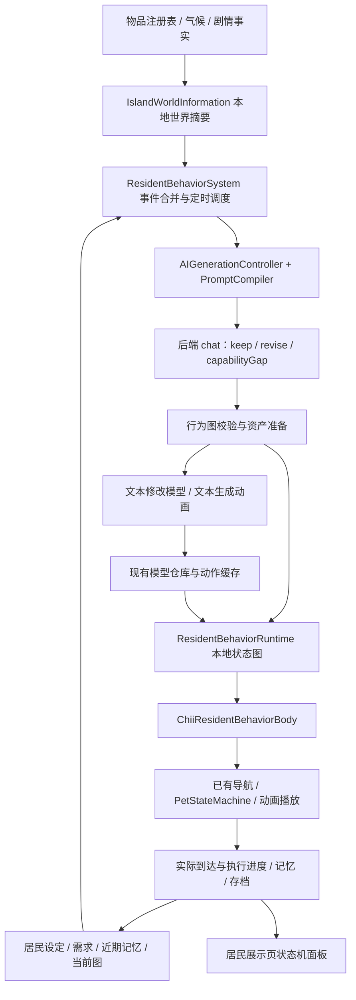

# Chii Island 节日表与居民作息

## 从玩家看到的两类行为出发

居民个人页回答「平时这个时候，它在哪里、做什么」。主岛节日表回答「这场节日有哪些节目，谁负责什么，谁和谁合作」。同一居民可以有长期的日常偏好，也可以在每场节日承担不同职责。

| 玩家入口 | 显示和操作 | 数据来源 |
|---|---|---|
| 居民展示 → 行为 | 查看四个时段的作息、预览可用动作、用文字调整整体或某一时段 | 居民性格、岛屿时钟、按岛与居民保存的调整 |
| 主岛 → Esc 岛屿手札 → 岛上节日表 | 浏览内置与自创节日，查看分工，举办已准备好的节日 | 当前岛的活动登记册与内置方案 |
| 节日详情 → 居民头像 | 节目、该居民的角色和动作、同场伙伴、合作说明；举办期间显示现场阶段和动作 | 这场节日的节目及现场执行快照 |

## 日常作息

岛屿时钟划分为清晨 06:00–10:00、白天 10:00–14:00、午后 14:00–18:00 和夜晚 18:00–次日 06:00。初始作息从性格与已有动作中构造。例如 mako 清晨沿小路慢跑，fangk 白天巡查建筑，午后居民到可达的树荫或休息处歇息。目标消失时，本地执行器重新寻找合适地点。玩家指令和五分钟岛况复查可调整各时段的动作组合。旧作息中的日常与工作设置参与默认值迁移。

现场集合、表演、对话等交互优先取得身体控制。结束后执行器按**当前**时段重新选择动作。晨练、摘苹果、生日专属演出及原有的收尾对话继续使用已有活动逻辑。

## 从想法到举办

1. 玩家在节日表点「策划节日」。fangk 依次问节日名字、主题、希望大家一起做什么。回答保留在当前访谈中，可以返回上一步修改。
2. 最后一问提交后，fangk 告知玩家可以去逛逛，面板关闭并释放移动控制。任务按当前岛保存；重新打开节日表可以继续浏览旧节日，头像旁显示「编排节目」或「准备动作和道具」。
3. `FestivalBook` 通过内容控制器发起 `event.plan`，输入包括三项回答、岛民 ID、性格、当前造型的可用动作以及岛上可用物体。AI 编排一至五个节目，给每位岛民确定角色和一至六个动作，并描述合作与道具。玩家给定的名字用作正式名称。
4. `compileFestivalProgram` 校验节目编号、参与人、角色、动作和素材提示。首版格式有误时将具体错误反馈给 AI，允许一次自动重编。每个节目以参与人最长动作序列确定时长，较短的序列在该节目剩余时间观看，下一项节目同步开场。
5. 保存通过校验的方案。缺少的动画按角色模型版本、动作描述、时长和播放参数缓存；需要的新道具模型通过体素生成服务准备。这个阶段不预留居民、添加舞台道具或占用玩家控制。素材齐备后登记整场方案、将节日置于列表前部，并在屏幕顶部通知。请求失败显示原因，可继续筹备或放弃。刷新页面会中断浏览器中的任务；已保存的方案和就绪素材可用于续办。
6. 玩家点「举办节日」后，`TownSocialSystem` 预留场地与名单，复用素材，分配实际可达站位。集合成功的成员按同一份方案与公共时钟表演。节日表展示实际阶段和当前动作。活动收尾释放站位与居民；登记册保留完整策划名单供下次举办。

## 节目与参与关系

| 结构 | 内容与用途 |
|---|---|
| `brief` | 名字、主题和集体活动设想，随登记方案保存 |
| `festivalProgram.events` | 唯一节目编号、标题、公共时长 |
| `festivalProgram.cast[id]` | 本场角色，以及引用节目编号的动作、时长、可用动画或生成提示 |
| `festivalProgram.links` | 指定两位居民与合作说明。共同参加节目自动产生同场关系 |
| 登记资产 | 道具引用与按模型版本缓存的动画。日常偏好和本场编排分别保存 |

网图每个圆代表一位岛民。主持职责、实际参与节目数、表演或观看的动作数及直接合作数共同决定圆的大小与距中心的位置。实线表示明确合作，虚线表示共同参加节目。选择头像会高亮它的连线，并按开演顺序列出它的任务。生日、春节等原有节日使用预设角色与专属阶段生成详情，历史自定义节日也能从登记册重新打开。

这套流程参考了 Voxel-Resort 狂欢节将整体节目、逐人动作、素材准备分别建模的思路。Chii 的访谈、保存方式、集合导航和节日收尾使用本项目的交互与运行系统。

## 验证入口

`npm test` 检查节目校验、时段边界、角色绑定、素材失败续办和现有活动。运行本地主岛后，`node scripts/verify-resident-themes.mjs` 用可控的服务响应演练三问、筹备期间行走、刷新后重开、关系图、举办、现场动作及独立日常编辑；集合测试把参与者放到导航器分配的真实站位。桌面与窄屏截图在 `.agents/runtime`。

## 旧版动作图设计记录

日期：2026-11-18（工作开始于 11 月 17 日）。此文描述本轮实现；保持原有剧情、居民身份、玩家操作、世界资产和身体状态系统。

## 1. 产品行为

本地保存小型、可解释的世界事实。物品增删、位置与描述变更、天气或整点时段改变，触发居民重新考虑安排；即使没有事件，也每 300 秒更新一次。居民依据稳定性格、偏好、需求、记忆和当前行为，保留或修订一个近期状态图。图在本地持续执行，不在每个状态或每帧调用模型。

例如：树木提供阴凉休息机会，居民可以前往共同地点，在不同空闲站位休息；玩家移除树林后，原目标立即失效。新建咖啡厅进入事实摘要，AI 可以改为到咖啡厅附近休息。这里的“聚会”是多个自主居民选择同一地点，不强制其他居民加入；咖啡厅当前使用建筑外可达地点，不声称完成点单、喝咖啡或室内互动。

居民展示页提供独立的「查看行为状态机」按钮，显示当前节点、成功／失败跳转、持续时间、规划理由、等待切换的新安排及最近八次修订。首次打开即可查看性格日常，也可从 `player-candidates.html?routine=fangk` 直接打开。已有存档时显示岛上的执行进度，也可以输入要求调整动作、顺序和时长。

## 2. 分层与所有权



| 层 | 权威数据／职责 | 实现 |
| --- | --- | --- |
| 世界事实 | 实体存在性、描述、位置、内容版本；摘要不包含几何与定位信息 | `src/gameplay/agents/IslandWorldInformation.js` |
| 调度 | 事件合并、五分钟刷新、一次批量规划、过期检查 | `src/gameplay/agents/ResidentBehaviorSystem.js` |
| 规划协议 | 有限状态、已有目标、已有动作与新动作申请 | `ResidentBehaviorPlan.js`、`prompts/ResidentBehaviorPrompt.js` |
| 居民行为 | 当前图、待切换图、节点进度、历史、执行结果 | `ResidentBehaviorRuntime.js` |
| 身体执行 | 可达站位、已有导航、表现素材准备与恢复 | `systems/ChiiResidentBehaviorBody.js` |
| 居民人格 | 身份、稳定偏好与性格、需求、记忆 | 原 `AnimalAgentRuntime`、profile、memory |
| 身体状态 | 跟随、对话、工作、自由活动及恢复策略 | 原 `PetStateMachine` |
| 存档 | 场景隔离的 Auto／Record 与居民记录 | 原 `AnimalAgentStore`、snapshot extension |
| 展示 | 性格日常、玩家修改、当前节点与跳转 | `presentation/ResidentBehaviorPanel.js` |

新系统在主岛启用。外部 WorldForge 探索地图保持已有漫游模式，避免无意引入生成和岛屿改造行为。`main.js` 的渲染、物理和更新顺序不变。

## 3. 世界信息结构

本地完整记录包含 `scope / revision / fingerprint / at / trigger / objects / events / climate / story`。

每个对象有 `id / name / description / tags / region / affordances / version`，本地另存位置和实际实体引用。内容版本覆盖描述、位置与外形／放置信息。更新不改变实体身份；删除使旧目标立即不可用。临时活动道具、室内对象和建筑草稿不进入摘要。

发给 AI 的信息最多 80 个具体对象、32 个近期变化，另带全岛对象／树荫／休息地点总数。普通对象、树木和其他休息地点交错抽取，避免大量树木挤掉新咖啡厅。当前位置与导航坐标留在本地，AI 只引用 ID。

本轮用既有名称、描述与标签推导有限机会：树木提供 shade/rest/gather；咖啡厅与长椅提供 rest/gather；所有摘要对象可作为观察背景。描述文本只提供语义上下文，不能增加代码执行权限或创造交互效果。后续可用显式 `affordances` 替换关键词识别，接口保持不变。

所有居民目前共享全岛摘要。这是全局信息实验，尚未实现视线、听觉与消息传播。

## 4. 调度与一致性

1. 注册表在事实提交后通知。无语义变化的 metadata 更新忽略；连续变化合并两秒。
2. 当前目标变更或删除，立即取消动作与待安装计划，不等待 AI。
3. 气候／剧情摘要每秒检查，按整点和天气等语义变化触发；正常五分钟刷新不依赖事件。
4. 所有居民合为一次 chat 请求，仍返回每个居民独立决策。
5. 同一系统仅有一个规划任务；执行期间继续收集事件。响应检查世界事件序号、居民 epoch、模型版本与生命周期。
6. 新响应或资产准备失败，保留有效旧计划。没有有效计划时，立即安装明确标注的本地备用图。
7. 新计划通常在当前节点结束后安装。相同当前动作只更新未来跳转，不重置执行对象或进度；显式 interrupt 可立即切换。
8. 循环等待与单纯安装计划不会再次触发规划，避免“改计划 → 又改计划”的循环。

五分钟是活跃岛屿模拟时间；页面退出后不运行，也不后台推进 NPC。配置位于 `ResidentBehaviorSystem` 构造参数，默认为 `intervalSeconds: 300`、`debounceSeconds: 2`。

## 5. 行为图协议

```json
{
  "residentId": "momo",
  "decision": "revise",
  "reason": "树林已经消失，去咖啡厅附近歇一会。",
  "switchPolicy": "afterCurrent",
  "graph": {
    "schemaVersion": 1,
    "entryStateId": "go",
    "states": [
      { "id": "go", "name": "前往咖啡厅", "kind": "visit", "targetId": "cafe-id", "seconds": 120, "onSuccess": "rest", "onFailure": "wait" },
      { "id": "rest", "name": "在咖啡厅附近休息", "kind": "wait", "targetId": "cafe-id", "seconds": 45, "onSuccess": "rest", "onFailure": "wait" },
      { "id": "wait", "name": "等道路畅通", "kind": "wait", "seconds": 20, "onSuccess": "go", "onFailure": "go" }
    ]
  }
}
```

图支持 1–12 个可达节点，所有成功／失败边必须指向图内节点，单状态时长 1–120 秒：

- `visit`：本地解析目标附近空闲站位，导航移动；实际到达才成功，超时走失败边。
- `wait`：停留休息。带目标时先核实距离，不在远处假装到达。
- `perform`：播放已有动画，或使用 `generation: { prompt, modelChange? }` 申请新表现。

`keep` 保持图与进度；`capabilityGap` 显示不足并保留旧安排。不能运行 AI 脚本、任意 actionId、直接坐标或世界写入。原行动审批系统仍负责世界创造、建筑和活动等独立玩法。

## 6. 模型／动作生成

执行链：具体动作需求 → 中文短指令校验 → 既有 `AIGenerationController` → `VoxelContentAdapter` → 后端 → 校验 → 缓存 → 安装。

- 新动作提示词最多 12 字，默认生成 3 秒、无粒子动作循环；最多每居民每轮两个新动作。
- 在线接口已验证：chat 显式传 `stream: false`；动画使用 `/api/generate/animation-quick`。当前服务返回采样动画 `baked`，兼容层验证帧率、时长、节点和采样值，再交给本地插值播放；旧 Motion Plan 保持原路径。最终动作时长／循环方式尊重后端实际结果。
- 需要模型变化时，先调用 `model.refine` 保留角色身份，再对返回的准确模型调用 `animation.generate`。不把旧模型的动画直接绑定到不兼容的新模型。
- 缓存键包含场景、居民、准确模型内容摘要和提示词；并发同键由既有 cache 合并。
- 模型通过现有 `AIWorldActionService`／`GeneratedAssetRepository` 保存；动画复用 `TownActivityAssetCache` 的持久化缓存。
- 资产在后台准备，未准备成功前旧行为继续执行；过期返回可留在资产历史，但不得安装到居民身上。
- 模型变体仅在对应动作中显示；结束、失败、让出控制权时恢复原模型。变体不会永久改写玩家装备或居民基础身份；若另一个系统已经更换模型，不覆盖它的新结果。
- 新动作是视觉表现，不自动生成杯子、食物、树木或改变资源。真实世界操作依然需要相应的现有交互流程。

当前实现每批最多一次 chat，资产逐居民串行准备；不做无限重试。失败后在下一次世界变化、定时刷新或显式开发调试请求时重试。生成缓存可能长期增长，后续可增加面向玩家的预算与缓存管理设置。

## 7. 暂停、恢复与存档

居民跟随、对话、工作或进入既有忙碌状态时，行为图让出身体控制权。恢复自由活动后重新核实位置和目标；不会将旧路径恢复到已经改变的环境。

居民快照新增可选 `behavior`，旧档仍可读取。保存图、当前节点、耗时、世界版本、理由、来源、错误与八条历史；不保存 Three 对象、运行中的 Promise、导航路径或实体指针。已有 Auto／Record extension 一并保存和恢复。

读档后使用既有持久化实体 ID 重新核对目标与内容，已有动作图恢复合法节点；等待节点可恢复累计时间。移动重新从真实站位寻路，生成动作图优先从准确模型版本的缓存恢复，不因读档隐式发起生成。缺少缓存或无效目标时回落到当前世界的备用安排，交给下一次规划判断。未完成模型请求不会跨 epoch 安装。

## 8. 验证与边界

自动回归在 `tests/resident-behavior.test.js`，覆盖世界摘要界限、树木移除与咖啡厅替代、非法图、真实到达、失败分支、进度保持、跟随暂停、慢响应／读档／销毁隔离、五分钟刷新、缓存模型兼容及共享 Prompt 编译。

`node scripts/verify-resident-behavior.mjs` 使用隔离浏览器上下文和固定 chat 响应，验证真实主岛接线、导航到达、存档、刷新后目标复核与桌面／窄屏展示。这是本地执行链验收，不替代真实模型服务质量验收。

当前未实现：长期剧情导演、局部感知、强制多居民协作协议、自动创建建筑／消耗品、咖啡厅完整室内生活、永久角色形态进化。后续可在现有事实／能力和图协议上增加明确操作，不需要重写渲染或身体系统。

### 本轮验收记录（2026-11-18）

- `npm run verify`：406 项测试通过，密钥扫描、71 项剧情资产基线、活动资产审计、渲染兼容与生产构建通过。
- `chii-verify --full`：最终复测桌面／窄屏 WebGL、模型、WASD、E 对话、Esc 面板均通过且无浏览器错误。此前一轮记录过一次远端 502；未忽略此错误，后续完整复测通过。服务失败时仍走保留当前有效安排的分支。
- `verify-resident-behavior.mjs`：7 位居民接收图；删除旧树目标立即取消；新增咖啡厅后 momo 实际导航到达并进入休息；读档不恢复已不存在的测试咖啡厅；展示页 1440×900／390×844 均可用，Esc 关闭恢复按钮焦点；无页面脚本错误。
- 真实 chat（不是固定响应）：momo 返回「走向树 → 树下休息 → 友好挥手」的有效图，约 3.7 秒。
- 真实动画：文本「双手缓缓向上伸展」生成两个上臂采样轨道，约 17.3 秒；两条轨道均绑定真实模型，时序求值有运动，居民进入 running。
- 模型 refine → 对应模型动画 → 临时显示 → 恢复原外观的事务链通过替身后端测试；本轮没有额外调用真实 refine 修改居民模型。
- 在线验证命令：`node scripts/verify-resident-behavior-live.mjs --live`。自动测试不包含此命令；运行它会调用后端。单独动画验证可加 `--animation-only`。

浏览器报告与截图写入忽略目录 `.agents/runtime/`。保留既有大 bundle 提示，未改动冻结游戏资产或部署线上版本。

## 居民的起始日常与玩家修改

七位居民共用 `data/residentRoutines.js` 中的起始计划。展示页首次打开即显示循环、动作持续时间和跳转，主岛使用同一份计划。玩家的自然语言要求通过 resident.behavior 编译为可验证的状态图，编辑页只使用该角色已有的动作。计划按场景、居民单独保存。主岛收到跨标签页修改时立即采用，在重新进入时也会读取，并在后续世界规划中继续提供玩家偏好。规划失败时保留先前安排。
